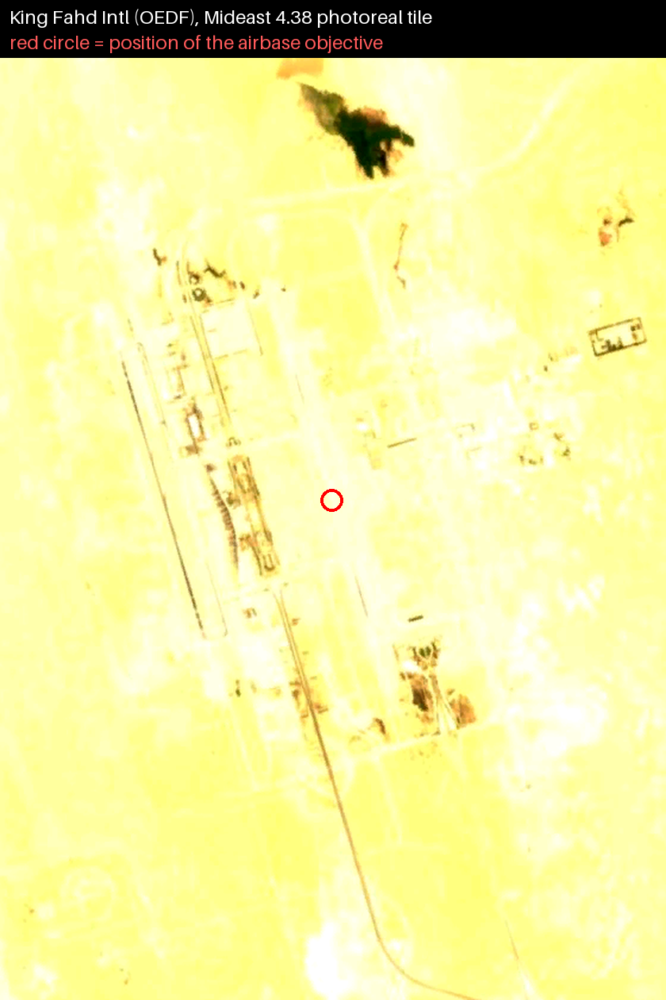

Thanks everyone for flying it and for the feedback, the good and the bad: it's exactly what a first release needs.

**Some background.** Mideast128 was built for the old terrain, where a few hundred meters didn't show. On photoreal New Terrain every meter shows, so for this release all 141 airbases were checked against their real positions: 117 were moved onto their real runways and 51 that used Korean layouts were rebuilt with complete 4.38 bases. Hundreds of objectives, bridges and coastal sites were also fixed by hand.

**About the offset.** I checked it today, base by base, and found two different things.

1. **The 3D world is aligned.** Terrain, photoreal and objects use the same georeference. As an example, here is King Fahd International: the red circle is where the airbase objective sits, and it falls right on the real airport in the photoreal tile.

2. **The lat/long coordinates are not.** The projection in Theater.txt doesn't include the correction used to build the terrain. Close to Kuwait the error is a couple of hundred meters, but it grows with the distance from the theater center: at King Fahd the DED shows the base about 4 km south of its real coordinates. So anything that works in lat/long (DED, DTC, Tacview) is off by up to a few km, even if the 3D world is right. That's a real bug, thanks @I-Hawk for pointing at it, and it will be fixed in **1.0.1**.

**About the photoreal quality.** Also fair. The current tiles are 4K over 64 km, about 15 m per pixel, so at low altitude airports and cities hardly show, and up close the procedural texture takes over. A **16K** version is the next step.

If you find something wrong, please post the place (name or coordinates) and a screenshot: that's the fastest way to get it fixed.

A theater is never finished, and sharing it is how it gets better. That's also the idea behind the BMS Suite: tools that make theaters easier to check and improve, so that more people feel like improving them. Its checks (objectives off the terrain, bridges over no water, misplaced runways) work on any theater, and I'm happy to share them with any theater author who wants them.

Thanks again to SpbGoro for the original theater, and to everyone flying it.
